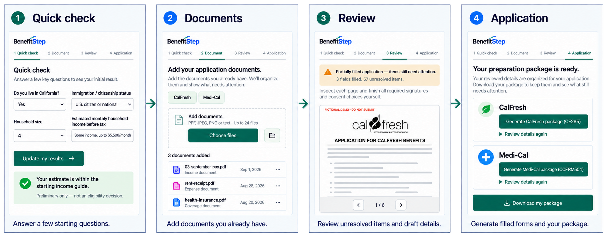

# BenefitStep

A free Chrome extension that helps California families prepare CalFresh and Medi-Cal paperwork from the documents they already have. It reads pay stubs, bills and receipts on your own computer, flags what does not match, and fills in unsigned drafts of the official forms. You check every value, then sign and submit the application yourself.

[Website](https://aiscihub.github.io/benefitstep/) · [Chrome Web Store](https://chromewebstore.google.com/detail/benefitstep-%E2%80%94-benefits-ap/bcakkdmdiacifncmldgblfnahnghpifi) · [Privacy policy](PRIVACY.md)



*Illustration of the four steps. Screen details may differ from the current version.*

## What it does

1. **Quick check (optional).** Answer a few questions to see how your income compares with the CalFresh income guide. It is a first look, not a decision.
2. **Documents.** Add the pay stubs, rent receipts, bills and letters you already have, as PDFs or photos. BenefitStep finds the names, dates and amounts.
3. **Review.** See each detail with the document it came from. Fix what is wrong and confirm what is right.
4. **Application.** BenefitStep fills in the official form with what you confirmed, shows the draft, and lists what is still missing. Download the package and finish it yourself.

Your work is temporary: download the package before you close or reload the panel.

## Forms

| Form | Used for | Can be filled in |
| --- | --- | --- |
| CF 285 | New CalFresh application | English, Spanish, Traditional Chinese, Vietnamese |
| CCFRM604 | Medi-Cal application | English |
| CF 37 | CalFresh recertification | English |
| SAR 7 | CalFresh periodic report | English, Spanish, Traditional Chinese, Vietnamese |

These are California's own PDF forms. English is the default; the other editions are a choice on the Application step. Answers are written as you entered them and are not translated.

The interface is available in English, Spanish, Simplified Chinese, Traditional Chinese and Vietnamese. The translations are drafts and some screens are still in English. See [MULTILINGUAL_INTEGRATION.md](MULTILINGUAL_INTEGRATION.md).

## Install

**From the Chrome Web Store:** open the [store page](https://chromewebstore.google.com/detail/benefitstep-%E2%80%94-benefits-ap/bcakkdmdiacifncmldgblfnahnghpifi) and choose **Add to Chrome**.

**From this repository:**

1. Download or clone the repository.
2. Open `chrome://extensions` in desktop Chrome 138 or later.
3. Turn on **Developer mode**, choose **Load unpacked**, and select the [`extension/`](extension/) folder.
4. Pin BenefitStep and open its side panel.

There is nothing to build. The extension does not work on phones.

## Try it with fictional documents

- In the panel, choose **Try example documents** to walk through every step with built-in example data.
- [Earley household](demo/earley-household/README.md): a five-person household, from documents to both application drafts.
- [Alex Demo](demo/test_example2/README.md): a smaller pack of four PDFs.

Never submit an application made from the example documents.

## Privacy

- Your documents are read inside the extension. They are not sent to BenefitStep, a cloud AI service or any agency.
- There is no account, no advertising and no analytics.
- Nothing is kept after you close the panel unless you download it.
- Photos and scans can be read by the AI built into Chrome, which runs on your computer. It stays off until you turn it on.

Full text: [PRIVACY.md](PRIVACY.md).

## Limits

- BenefitStep is not a government service. It is independent of BenefitsCal, the state and county offices.
- It does not decide whether you qualify, and it does not sign or submit anything.
- The forms it produces are unsigned drafts. The form mappings have not had independent review.
- It can misread a document. Check every value against the original.
- On 26 fictional test files, the text reader filled in 68 values and 66 matched the document. See [how it was tested](https://aiscihub.github.io/benefitstep/evaluation.html) and the [test files](demo/evaluation/README.md).

## In this repository

| Folder | Contents |
| --- | --- |
| [`extension/`](extension/) | The extension as it is packaged for the store |
| [`releases/`](releases/) | One folder per release: the upload ZIP, its checksum and release notes |
| [`demo/`](demo/) | Fictional document packs and the evaluation test files |
| [`docs/`](docs/) | The website |
| [`tests/`](tests/), [`scripts/`](scripts/) | Tests and the evaluation script |

## Tests

```sh
node --test tests/*.test.mjs        # unit tests
python3 tests/i18n-browser.py       # interface languages, in Chrome (also --chinese, --traditional, --vietnamese)
node scripts/evaluate-reader.mjs    # the document-reader evaluation
```

The browser checks need desktop Chrome and Python 3.

## License

[MIT](LICENSE). Bundled libraries keep their own licence notices under `extension/vendor/`.
